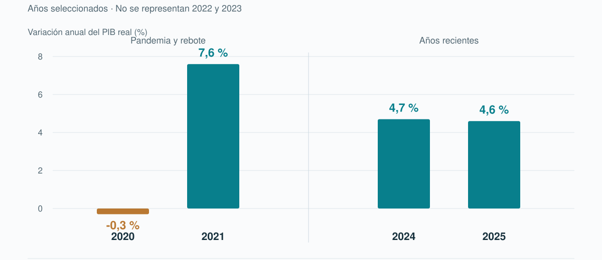

# Kenia: crecimiento, instituciones y vivienda de alquiler para trabajadores en Nairobi

**Cristina Moro · África en el siglo XXI**

## 1. Introducción

Kenia alcanzó la independencia en 1963 con una economía y unas relaciones de acceso a la tierra marcadas por el dominio colonial. La expansión de la pequeña agricultura y la intervención pública dieron paso, desde los años ochenta, a reformas de liberalización y a una mayor participación privada (Gamba & Kibaara, 2007). El crecimiento posterior de los servicios y la innovación ha convivido con diferencias de acceso al empleo y a las oportunidades. Este trabajo plantea que la construcción de vivienda para alquiler en Nairobi puede atraer inversión y mejorar las condiciones de vida de trabajadores, siempre que el producto sea compatible con sus ingresos y se apoye en suelo jurídicamente seguro, servicios adecuados y contratos previsibles. El marco de instituciones inclusivas y extractivas de Acemoglu y Robinson permitirá examinar quién accede a esas oportunidades y cómo se distribuyen los beneficios. Se elige Acorn Holdings como empresa principal y se compara con IHS y Fusion Capital.

## 2. Características del mercado e integración regional

Kenia es un mercado de 53,3 millones de habitantes según la proyección nacional para 2025, recogida por KNBS y el Consejo Nacional de Población y Desarrollo. Se utiliza la serie demográfica nacional (Kenya National Bureau of Statistics, 2026; National Council for Population and Development, 2025). El PIB nominal alcanzó aproximadamente 17,58 billones de chelines en 2025 (Central Bank of Kenya, s. f.; Kenya National Bureau of Statistics, 2026). Esta cifra permite dimensionar la economía nacional. Para estimar la demanda de vivienda del proyecto, es necesario analizar los ingresos, gastos y necesidades de los hogares a los que se dirige.

Según el *Economic Survey 2026* de KNBS, el PIB real de Kenia creció un 4,6 % en 2025, frente al 4,7 % de 2024. El Banco Central de Kenia reproduce estas cifras en su serie de PIB anual (Central Bank of Kenya, s. f.; Kenya National Bureau of Statistics, 2026). Para valorar las implicaciones de este crecimiento sobre la demanda de alquiler en Nairobi, es necesario estudiar los ingresos y la estabilidad laboral de los hogares destinatarios.

El informe Gross County Product 2025 identifica a Nairobi como la ciudad-condado que más valor añadido genera en el país. Esta concentración de actividad justifica estudiar su mercado residencial. Para diseñar la promoción, sin embargo, es necesario identificar qué hogares podrían alquilarla y cómo accederían desde ella a sus centros de trabajo (Kenya National Bureau of Statistics, 2025).

Por lo tanto, se puede dilucidar que el mercado laboral limita el tamaño de la demanda solvente. La encuesta económica de KNBS muestra que la mayor parte del empleo creado en 2025 se concentró en el sector informal. La estadística excluye la pequeña agricultura rural y las actividades pastoriles y se refiere al país, no específicamente a Nairobi. Por ello, el crecimiento agregado resulta insuficiente para estimar la estabilidad de los ingresos de los futuros inquilinos (Kenya National Bureau of Statistics, 2026).

Para estudiar la capacidad de pago también hay que conocer los gastos y obligaciones del hogar. Se identifican restricciones de acceso a vivienda incluso entre personas vinculadas a fondos de pensiones (Shah et al., 2026). El cliente propuesto será, por ello, un hogar pequeño de trabajadores con ingresos documentables, sin presentar el proyecto como solución para toda la población de bajos ingresos.

La Comunidad de África Oriental reúne actualmente ocho Estados. Somalia se incorporó como miembro pleno en marzo de 2024. La EAC favorece un marco de cooperación económica cuya relación con el proyecto sería indirecta: actividad empresarial, inversión y movilidad. El mercado residencial de la promoción seguirá siendo local (East African Community, s. f.).

## 3. Activos productivos y condiciones para invertir

La experiencia en servicios digitales ofrece herramientas para gestionar el alquiler. M-Pesa ilustra el uso de telefonía móvil para transferir dinero, aunque el acceso a estos servicios presenta desigualdades (Banco Mundial, 2020). Para un operador residencial, los pagos digitales pueden facilitar cobros y registros. Se trata de una posible mejora de gestión aunque la solvencia del inquilino dependerá de sus ingresos y obligaciones.

Otro activo es la existencia de organizaciones capaces de desarrollar y gestionar vivienda con inversión institucional. Se describen actividades de desarrollo y adquisición de vivienda en Nairobi y otras zonas urbanas, con criterios de eficiencia de recursos y colaboración con promotores (International Finance Corporation, 2024). Este precedente muestra una vía para organizar capital destinado a vivienda. Una nueva operación necesitaría justificar su demanda, sus costes y la modalidad de tenencia.

El contexto de inversión debe distinguir flujos anuales y capital acumulado. Las entradas de inversión extranjera directa en Kenia alcanzaron 1.503 millones de dólares en 2024, cifra redondeada a 1.500 millones en otra publicación del mismo organismo (United Nations Conference on Trade and Development [UNCTAD], 2025a, 2025b). Se trata de flujos nacionales, no de recursos disponibles para vivienda.

La iniciativa de Acorn para ampliar el alquiler y el programa de International Housing Solutions muestran precedentes de organización institucional de capital (International Finance Corporation, 2024; Private Infrastructure Development Group, 2025). Su desarrollo es una oportunidad condicionada por demanda y ejecución, no una promesa automática de financiación del proyecto.

El suelo requiere un tratamiento institucional específico. La Constitución establece en su artículo 65 que las personas no ciudadanas pueden disponer de suelo mediante leasehold por un máximo de 99 años, y define cuándo una sociedad se considera ciudadana a estos efectos. Antes de adquirir la parcela habrá que comprobar el título, la duración del derecho y la estructura de propiedad de la sociedad inversora (Constitution of Kenya, 2010).

El funcionamiento de agua, saneamiento, electricidad y transporte condiciona el coste de residencia. Estas condiciones deben verificarse en la ubicación elegida: las capacidades nacionales no aseguran servicios suficientes para una parcela concreta. La evaluación del inmueble incluirá tanto su calidad constructiva como los gastos y las condiciones de uso para sus residentes.

## 4. Evolución económica y análisis institucional

### 4.1. Independencia, expansión y límites del modelo inicial

El diagnóstico sistemático del Banco Mundial de 2020 distingue una primera fase de crecimiento intenso tras la independencia, un periodo prolongado de desaceleración y una recuperación posterior. La expansión inicial descansó en capacidades agrícolas y políticas de promoción económica; la desaceleración posterior mostró sus límites. La relación entre decisiones públicas, incentivos privados y acceso a recursos explica mejor esa trayectoria que una clasificación permanente del país como éxito o fracaso (Banco Mundial, 2020).

La trayectoria inicial estuvo relacionada con la expansión agrícola y la transformación de la participación de pequeños productores. El análisis de políticas también sitúa la liberalización en una secuencia posterior de retirada de determinadas funciones públicas y mayor intervención privada. Desde el marco institucional, la pregunta relevante es qué grupos pudieron utilizar los nuevos derechos y oportunidades, y cuáles quedaron excluidos. La existencia de propiedad privada no equivale, por sí sola, a acceso inclusivo a la tierra, financiación o servicios (Gamba & Kibaara, 2007).

### 4.2. Restricciones externas, ajuste y costes sociales

Desde 1980, Kenia aplicó programas de ajuste estructural que buscaban aumentar la participación de las empresas privadas y orientar la producción hacia la exportación. Sus resultados deben analizarse teniendo en cuenta tanto la situación previa del país como las decisiones del Gobierno, sin atribuirlos a una sola causa (Gamba & Kibaara, 2007).

Estas reformas incluyeron privatizaciones y cambios en el empleo público y el gasto del Estado. Para valorar sus efectos, hay que estudiar cómo afectaron a los distintos grupos sociales. Una mejora de las cuentas públicas puede coexistir con dificultades de algunas familias para acceder a servicios básicos. Por eso, los indicadores económicos no bastan para conocer sus consecuencias sobre el bienestar (*Kenya national human development report 2006*, 2006).

Esto ayuda a entender por qué el salario no basta para calcular cuánto alquiler puede pagar un hogar. Si una familia tiene que destinar más dinero a servicios esenciales, le queda menos para vivienda. Por ello, el proyecto deberá valorar tanto los ingresos como los gastos de sus futuros inquilinos.

### 4.3. Recuperación, servicios y Africa Rising

La recuperación posterior se apoyó en el dinamismo de los servicios. El diagnóstico del Banco Mundial de 2020 destaca su contribución al crecimiento y, al mismo tiempo, las dificultades de productividad, empleo e inclusión. La experiencia keniana matiza la narrativa de Africa Rising: el crecimiento de los servicios ofrece una trayectoria distinta de la expansión apoyada en un recurso extractivo, pero tampoco asegura por sí mismo una mejora general de las condiciones de vida (Banco Mundial, 2020).

El desarrollo de pagos móviles añade una dimensión institucional: una innovación puede reducir obstáculos para operar en la economía. Sin embargo, extender los medios de pago no distribuye automáticamente la productividad ni elimina las diferencias territoriales. Para defender una inversión residencial se necesita comprobar que existen clientes capaces de mantener el alquiler, y que el proyecto no se limita a atender al segmento con mayores ingresos mientras se presenta como respuesta general al problema urbano.

### 4.4. Pandemia, recuperación y restricciones recientes

La pandemia mostró la vulnerabilidad de los ingresos y la diferencia entre actividad agregada y bienestar. La serie de KNBS publicada en 2026 y la tabla de PIB anual del CBK sitúan la contracción de 2020 en el 0,3 % y el rebote de 2021 en el 7,6 %. El repunte reflejó reapertura y recuperación sectorial, por lo que no debe extrapolarse como ritmo permanente (Central Bank of Kenya, s. f.; Kenya National Bureau of Statistics, 2026).

Los shocks climáticos añaden otra limitación. El Economic Update de diciembre de 2024 señala que las inundaciones de ese año afectaron a medios de vida, especialmente urbanos, y limitaron el consumo. Para una promoción de alquiler, drenaje, exposición de la parcela y continuidad de servicios forman parte del análisis económico. Una vivienda físicamente disponible puede ser una mala solución si sus usuarios afrontan interrupciones o costes que no pueden asumir (Banco Mundial, 2024).

La situación fiscal exige prudencia con las propuestas públicas. El Budget Review and Outlook Paper de 2025 sitúa la deuda pública bruta en el 68,8 % del PIB para el ejercicio 2024/25, como resultado preliminar; el Economic Update del Banco Mundial de noviembre de 2025 recoge la misma ratio. Su implicación para el plan es evitar que la viabilidad dependa de incentivos fiscales amplios o de infraestructura pública cuya financiación no se haya identificado (Banco Mundial, 2025; The National Treasury, 2025).

**Figura 1**

*Crecimiento de Kenia: crisis y recuperación*

*Nota.* Elaboración propia a partir de *Economic Survey 2026* (Kenya National Bureau of Statistics, 2026) y *Annual GDP* (Central Bank of Kenya, s. f.). Años seleccionados; serie revisada.

### 4.5. Instituciones y transformación del crecimiento en bienestar

El marco de Acemoglu y Robinson (2012), desarrollado en *Why nations fail*, permite relacionar estas etapas sin atribuir todos los resultados al colonialismo ni a una única reforma. El análisis considera mecanismos concretos: cuando obtener un título o un permiso depende de contactos y rentas, disminuye la competencia y se concentra el acceso al suelo; cuando las reglas son previsibles y exigibles, más actores pueden invertir y contratar.

Freedom House considera al país parcialmente libre en su edición de 2026 y describe elecciones competitivas junto con problemas de corrupción y actuación de las fuerzas de seguridad. Es una evaluación de derechos y libertades, no una medida directa del riesgo de una promoción ni un sustituto del análisis legal. Sirve para cuestionar la equivalencia entre dinamismo económico y calidad institucional (Freedom House, 2026).

La aplicación al proyecto combina protección de la inversión y derechos del inquilino: revisión del suelo, contratación comprensible, competencia entre proveedores y publicidad de los cargos. Una operación que mejore edificios pero desplace a trabajadores o los obligue a un esfuerzo insostenible no demostraría inclusión. El DAFO recoge esa tensión entre capacidades empresariales y restricciones de ingresos, servicios y gobernanza.

## 5. DAFO de la economía de Kenia

Este DAFO recoge el análisis previo sobre la economía de Kenia, sin aplicarlo al mercado del alquiler.

| **Fortalezas** | **Debilidades** |
|---|---|
| Diversidad de actividades económicas. La presencia de agricultura, comercio, finanzas, transporte y servicios de información ofrece distintas fuentes de producción e ingresos. | Elevada informalidad laboral. El crecimiento económico no se traduce necesariamente en empleo estable, protección social y mejoras de ingresos para toda la población. |
| Desarrollo de servicios e innovación financiera. La experiencia en pagos móviles facilita transacciones y ofrece herramientas para ampliar la participación en la economía. | Desigualdad de acceso a las oportunidades. Persisten diferencias en el acceso al empleo, la financiación, la tierra y los servicios básicos, que limitan la distribución de los beneficios del crecimiento. |
| Concentración de actividad empresarial en Nairobi. La capital reúne empresas y servicios que pueden facilitar la inversión y las relaciones comerciales. | Restricciones fiscales. El elevado endeudamiento reduce el margen del Estado para financiar servicios, infraestructura y medidas de apoyo durante las crisis. |
| Capacidad para atraer inversión extranjera. Las entradas de inversión documentadas muestran vínculos con capital internacional que pueden contribuir al desarrollo productivo. | Problemas de gobernanza y seguridad jurídica. La corrupción y la falta de previsibilidad de determinados procedimientos pueden dificultar la competencia y elevar los costes de inversión. |

| **Oportunidades** | **Amenazas** |
|---|---|
| Integración regional. La participación en la Comunidad de África Oriental ofrece posibilidades de ampliar mercados y fortalecer las relaciones comerciales y empresariales. | Fenómenos climáticos extremos. Las inundaciones y otros episodios pueden dañar infraestructura, afectar a la producción agrícola e interrumpir la actividad económica. |
| Expansión de servicios digitales. Su desarrollo puede mejorar la gestión empresarial, facilitar pagos y ampliar el acceso a servicios financieros. | Cambios desfavorables en la financiación internacional. Un encarecimiento o una menor disponibilidad de capital puede dificultar la inversión y aumentar las presiones sobre las finanzas públicas. |
| Inversión orientada a diversificar y modernizar la producción. La captación de capital puede apoyar infraestructura, tecnología y actividades de mayor valor añadido, si existen condiciones adecuadas de ejecución. | Crisis económicas y sanitarias externas. La pandemia mostró que estas perturbaciones pueden reducir la actividad y los ingresos, incluso después de etapas de crecimiento. |
| Aprovechamiento de una población joven. Una mayor incorporación al empleo productivo puede ampliar la capacidad económica del país, siempre que vaya acompañada de formación y oportunidades laborales. | Incertidumbre política y tensiones sociales. Los problemas institucionales y las dificultades económicas pueden afectar a la confianza y a la continuidad de la actividad empresarial. |

El análisis muestra una economía con capacidades en servicios, innovación y atracción de inversión, pero con dificultades para convertir el crecimiento en bienestar generalizado. Su evolución dependerá de la creación de empleo productivo, la mejora institucional y la capacidad para afrontar las restricciones fiscales y los riesgos climáticos.

## 6. Plan de acción final: inversión en vivienda de alquiler en Nairobi

### 6.1. Propuesta de atracción de inversión

La apuesta de este trabajo es atraer inversión de largo plazo para construir y gestionar viviendas de alquiler en Nairobi, con Riruta como zona inicial de estudio. El producto combinaría estudios y viviendas de un dormitorio destinados a hogares pequeños de trabajadores con ingresos documentables, incluidos autónomos. La propuesta aprovecha tres fortalezas del DAFO: la concentración de actividad empresarial en Nairobi, la experiencia en servicios y pagos digitales y la capacidad de atraer capital extranjero. La oportunidad consiste en reunir esas capacidades en una oferta de alquiler con mantenimiento y atención al residente gestionados profesionalmente.

Se elige este sector frente a la vivienda para venta, las oficinas y el alojamiento turístico porque permite vincular la inversión con una necesidad residencial de trabajadores sin exigirles una compra ni una hipoteca. No se sostiene que sea el sector más rentable de Kenia: se defiende que es el que mejor conecta el objetivo social del trabajo con las capacidades empresariales documentadas. El hueco que se propone investigar es el de hogares que necesitan vivienda estable, pero no quieren o no pueden comprar. Su tamaño y su capacidad de pago deberán comprobarse antes de construir.

Riruta ofrece un punto de partida concreto porque cuenta con actuaciones residenciales documentadas. Un estudio ambiental sitúa el proyecto Keza–IHS en Ndwaru Road, Dagoretti South, y señala necesidades de seguridad peatonal (Centric Africa Ltd., 2025). Este antecedente justifica estudiar competencia, accesos y servicios en la zona; no demuestra que haya una parcela disponible ni que la demanda de otra promoción sea trasladable a la propuesta.

El inversor prioritario sería un fondo de capital de largo plazo especializado en vivienda, asociado con un promotor y gestor local. La inversión se canalizaría mediante una participación en la sociedad propietaria de las viviendas, manteniendo la propiedad y la gestión unificadas. Si el capital procede del extranjero, su clasificación como inversión extranjera directa dependerá de las características de la participación. Se priorizará una estructura financiera compatible con ingresos en chelines, para limitar el riesgo de pagar deuda en divisas con alquileres en moneda local.

El argumento de Kenia frente a una nueva implantación en Kampala o Kigali es la posibilidad de trabajar con empresas que ya cuentan con experiencia documentada en el mercado keniano. Esta base permite concentrar recursos en seleccionar la parcela, ajustar el producto y captar clientes, en lugar de crear toda la capacidad operativa desde cero. Es una ventaja de ejecución para esta propuesta; la información reunida no permite afirmar que Nairobi ofrezca mayor rentabilidad o menores costes que ambas ciudades.

Las debilidades del DAFO determinan el diseño: la informalidad y las restricciones presupuestarias obligan a estudiar ingresos y gastos reales, y los problemas de gobernanza exigen revisar suelo y permisos. La existencia de ingresos recurrentes no elimina las dificultades de acceso a vivienda (Shah et al., 2026). Por ello, no se fija todavía una tarifa ni se presenta el producto como asequible para toda la población de bajos ingresos.

### 6.2. Empresas objetivo y elección de Acorn Holdings como cabecera

Se seleccionan tres empresas reales por sus capacidades documentadas en vivienda y gestión de capital. Son candidatas a explorar, no inversores que hayan comprometido recursos para este proyecto.

**Acorn Holdings.** Es la primera opción y la empresa de cabecera. Combina desarrollo, propiedad y gestión de alquiler, y su estrategia contempla ampliar su actividad desde estudiantes hacia jóvenes profesionales y familias (Acorn Holdings, s. f.). Además, se ha anunciado un vehículo de inversión inmobiliaria orientado al alquiler para jóvenes urbanos que han terminado sus estudios (Private Infrastructure Development Group, 2025). Esta orientación encaja con el segmento propuesto mejor que una empresa dedicada exclusivamente a vender viviendas. El anuncio no acredita una promoción de Acorn en Riruta.

**International Housing Solutions.** Es la segunda candidata por su experiencia en fondos de vivienda y su programa keniano. Su actividad documentada contempla alquiler, venta y alquiler con opción de compra (International Finance Corporation, 2024). Podría aportar capacidad de inversión y relaciones con promotores, pero habría que acordar expresamente que la operación se mantuviera destinada al alquiler de larga duración. Por esta diferencia de modalidades, se sitúa como alternativa a Acorn y no como cabecera preferente.

**Fusion Capital.** Es la tercera candidata por su experiencia regional en vivienda de alquiler. La información sobre sus inquilinos permite identificar mejoras residenciales junto con dificultades de asequibilidad (Robinson et al., 2025). Su interés para la propuesta reside en esa experiencia operativa y en la posibilidad de contrastar decisiones de calidad y precio. La muestra del estudio no permite estimar la demanda de toda Nairobi ni confirma su interés en financiar una nueva promoción.

La elección de Acorn es una decisión del trabajo basada en información pública, no en una relación personal o profesional con la empresa. Se le asignaría la coordinación del diseño, la contratación, la captación de capital y la gestión posterior. Su valor añadido potencial sería mantener una responsabilidad clara durante todo el ciclo del inmueble, transferir experiencia de gestión y generar empleo y compras locales. La formación, las contrataciones y los proveedores deberán registrarse para comprobar esa aportación.

El mercado objetivo de Acorn serían hogares pequeños que valoren estabilidad residencial, mantenimiento y acceso al empleo. La concentración de actividad en Nairobi y la estrategia empresarial documentada justifican estudiar ese mercado, pero no permiten calcular todavía el número de clientes ni su disposición a pagar. Durante la preparación se compararán alquileres y viviendas alternativas y se consultará a trabajadores, empleadores y organizaciones profesionales. El presupuesto del hogar incluirá alquiler, suministros, depósito y transporte. La experiencia de Acorn en alojamiento estudiantil será un punto de partida de gestión, no una prueba de aceptación por parejas o familias.

La decisión es, por tanto, negociar primero con Acorn y utilizar International Housing Solutions y Fusion Capital como alternativas para contrastar condiciones. No se presupone un consorcio entre las tres. Si el coste total solo permite atender a hogares de mayores ingresos, se revisará el producto y su justificación social antes de aprobar la construcción.

### 6.3. Plan de acción 360º: medidas, responsables y plazos

El plan convierte las debilidades y amenazas del DAFO en actuaciones verificables. Los plazos se cuentan desde el inicio del estudio y son propuestas del trabajo, no compromisos asumidos por empresas o autoridades. Los meses 0–6 se dedicarían a demanda y parcelas; los meses 6–12, al diseño, las autorizaciones y la financiación. El calendario de obra se aprobaría después de completar esas comprobaciones.

| Palanca | Actuación y relación con el DAFO | Responsable propuesto | Plazo orientativo | Evidencia de cumplimiento |
|---|---|---|---|---|
| Formación y capital humano | Identificar puestos de obra, mantenimiento y gestión; acordar formación y prácticas remuneradas con un centro técnico local. Responde a la debilidad del empleo formal. | Acorn como promotor propuesto, contratista y centro técnico seleccionado | Definir perfiles y convenio en meses 0–6; ejecutar durante obra y operación | Convenio firmado; personas formadas y contratadas; seguimiento de continuidad laboral |
| Marco legislativo y regulatorio | Revisar título, duración del derecho sobre el suelo, uso permitido y estructura de inversión; elaborar contratos con cargos comprensibles y registrar permisos. Responde a los problemas de seguridad jurídica y gobernanza. | Asesoría jurídica local, sociedad promotora y autoridades competentes del condado de Nairobi | Revisión inicial en meses 0–6; autorizaciones antes de cada fase | Informe jurídico; título y uso comprobados; resoluciones administrativas; contratos revisados |
| Infraestructura y clima | Comparar parcelas por agua, saneamiento, drenaje, electricidad, transporte y seguridad peatonal; descartar ubicaciones sin soluciones técnicas y financieras viables. Responde a los riesgos climáticos y a las carencias de servicios. | Equipo técnico de Acorn, operadores de servicios y condado de Nairobi | Evaluación en meses 0–6; soluciones y costes definidos antes de aprobar la obra | Informe de parcela; evaluación de drenaje; costes y condiciones de conexión documentados |
| Incentivos administrativos | Solicitar coordinación de trámites e información clara de requisitos y tasas. Se elige esta vía frente a exenciones fiscales generales por las restricciones fiscales del país. | Promotor, Invest Kenya y condado de Nairobi | Iniciar en meses 0–3 y mantener durante las autorizaciones | Registro de requisitos, solicitudes, incidencias y tiempos; coste de tasas identificado |
| Financiación y capacidad de pago | Contrastar alquileres previstos con presupuestos de hogares y costes completos; evaluar menor ocupación, aumento de costes y riesgo cambiario. Responde a informalidad, inflación y dificultades de financiación. | Acorn, inversores potenciales y asesoría financiera | Estudio de hogares en meses 0–6; modelo financiero y decisión en meses 6–12 | Estudio de demanda; modelo con escenarios; estructura de financiación y condiciones de aprobación documentadas |
| Gestión e impacto | Implantar mantenimiento, registro de cobros digitales y canal de reclamaciones; comprobar compras locales, coste de residencia y posibles desplazamientos. Aprovecha capacidades digitales y aborda desigualdad y calidad del servicio. | Promotor-operador y proveedores | Diseñar antes de abrir; revisar trimestralmente durante el primer año de operación | Registros de mantenimiento y reclamaciones; ocupación y cobros; compras locales; seguimiento del esfuerzo de pago |

La coordinación administrativa no sustituye los controles. La aprobación de planos, las inspecciones y el certificado de ocupación son actuaciones distintas y deben verificarse por separado (Nairobi City County Government, 2025). El plan propone mejorar la preparación y el seguimiento de los expedientes; no atribuye al promotor capacidad para cambiar las normas ni garantiza plazos de resolución.

### 6.4. Decisión de inversión y seguimiento

La primera decisión será seleccionar una parcela y un producto compatibles con los ingresos del público objetivo. La segunda será aprobar un diseño con servicios, costes y permisos comprobados. Solo después se negociará el cierre de la financiación y la contratación de la obra. En cada fase se podrá detener o reformular la operación si no cumple las condiciones mínimas.

El modelo financiero incluirá suelo, construcción, financiación, mantenimiento, seguros, gestión y periodos sin ocupación. Se comprobará si el proyecto puede sostenerse con menor ocupación, retrasos y aumentos de costes. Cuando existan obligaciones en divisas, se documentará cómo se limita el desajuste con ingresos en chelines, sin presuponer que haya cobertura disponible.

Antes de aprobar la construcción deberán quedar documentadas la seguridad jurídica de la parcela, la viabilidad de los servicios, una demanda compatible con el coste total de residencia y una financiación identificada. No se contará con exenciones fiscales o infraestructura pública sin respaldo confirmado. Las metas de ocupación, mantenimiento y esfuerzo de pago se fijarán con el estudio inicial y se incorporarán al seguimiento del operador.

La apuesta final es impulsar alquiler de larga duración con Acorn como cabecera, Riruta como zona inicial de estudio y capital asociado a un operador local. El criterio para avanzar será que las capacidades empresariales se traduzcan en una operación sostenible y en mejores condiciones residenciales para los trabajadores. La rentabilidad, el servicio y el impacto sobre los residentes se evaluarán conjuntamente.

## 7. Conclusión

Kenia ofrece capacidades empresariales y urbanas que hacen razonable estudiar inversión residencial de largo plazo en Nairobi. Sin embargo, su evolución económica muestra que crecimiento, innovación y mejora del bienestar no avanzan necesariamente al mismo ritmo. La informalidad, las restricciones fiscales y la desigualdad de acceso a oportunidades condicionan tanto la necesidad de vivienda como la capacidad efectiva de pagarla.

La propuesta elige construcción para alquiler, Acorn como cabecera y Riruta como ubicación de estudio. La decisión se apoya en capacidades existentes y una estrategia empresarial compatible, mientras IHS y Fusion permiten contrastar otras formas de organizar capital y operación. No demuestra todavía una rentabilidad ni una demanda garantizadas; plantea una actuación cuya aprobación depende de pruebas de mercado y viabilidad.

Desde Acemoglu y Robinson, el criterio decisivo es cómo se organizan los derechos y las oportunidades. Contratos claros, suelo seguro, servicios y financiación deben proteger al inversor y hacer posible una residencia estable para el trabajador. El plan asigna responsabilidades para comprobar esas condiciones. La evaluación deberá atender a la sostenibilidad del negocio y a la mejora residencial que ofrece a los trabajadores.

## Referencias

Acemoglu, D., & Robinson, J. A. (2012). *Why nations fail: The origins of power, prosperity, and poverty*. Crown. https://www.penguinrandomhouseretail.com/book/?isbn=9780307719218

Acorn Holdings. (s. f.). *Overview*. Recuperado el 21 de octubre de 2026, de https://acornholdingsafrica.com/overview/

Banco Mundial. (2020). *Kenya systematic country diagnostic*. https://documents1.worldbank.org/curated/en/531731600090213005/pdf/kenya-systematic-country-diagnostic.pdf

Banco Mundial. (2024, 10 de diciembre). *Reforms are needed to stem a slow-down in Kenya’s economic growth*. https://www.worldbank.org/en/news/press-release/2024/12/10/reforms-are-needed-to-stem-a-slow-down-in-afe-kenya-s-economic-growth

Banco Mundial. (2025). *Kenya economic update 32: From barriers to bridges—Procompetitive reforms for productivity and jobs in Kenya*. https://documents1.worldbank.org/curated/en/099112125062524216/pdf/P507067-4f692fc7-8081-4630-9dd2-d3768ce9defc.pdf

Central Bank of Kenya. (s. f.). *Annual GDP*. Recuperado el 21 de octubre de 2026, de https://www.centralbank.go.ke/annual-gdp/

Centric Africa Ltd. (2025). *Environmental and social impact assessment study report for the proposed Riruta Keza IHS housing developments*. National Environment Management Authority. https://nema.go.ke/wp-content/uploads/2025/12/IHS-Riruta-Housing_00288-min.pdf

Constitution of Kenya, art. 65 (2010). Kenya Law Reform Commission. https://www.klrc.go.ke/index.php/constitution-of-kenya/116-chapter-five-land-and-environment/117-part-1-land/232-65-landholding-by-non-citizens

East African Community. (s. f.). *EAC at a glance*. Recuperado el 21 de octubre de 2026, de https://www.eac.int/component/content/?Itemid=89

Freedom House. (2026). *Freedom in the world 2026: Kenya*. https://freedomhouse.org/country/kenya/freedom-world/2026

Gamba, P., & Kibaara, B. (2007). *Structural implications of economic liberalization on agriculture and rural development: RuralStruc program, phase I*. Egerton University, Tegemeo Institute. https://documents1.worldbank.org/curated/en/886221468048846460/pdf/779820WP0KENYA00Box377319B00PUBLIC0.pdf

International Finance Corporation. (2024). *IHS Kenya: Environmental and social review summary (Project 47136)*. https://disclosures.ifc.org/project-detail/ESRS/47136/co

Kenya National Bureau of Statistics. (2025). *Gross county product 2025*. https://www.knbs.or.ke/wp-content/uploads/2025/12/2025-Gross-County-Product.pdf

Kenya National Bureau of Statistics. (2026). *Economic survey 2026*. https://www.knbs.or.ke/reports/2026-economic-survey/

*Kenya national human development report 2006: Human security and human development—A deliberate choice*. (2006). https://hdr.undp.org/system/files/documents/kenya2006en.pdf

Nairobi City County Government. (2025, junio). *Customer service charter*. https://nairobi.go.ke/wp-content/uploads/NCCG_Service_Charter_2025.pdf

National Council for Population and Development. (2025, 12 de marzo). *Press release*. https://ncpd.go.ke/2025/03/12/press-release/

The National Treasury. (2025). *Budget review and outlook paper*. https://www.treasury.go.ke/wp-content/uploads/2025/10/2025-Budget-Review-and-Outlook-Paper.pdf

Private Infrastructure Development Group. (2025, 17 de noviembre). *PIDG anchors Acorn’s new REIT to finance affordable housing for Kenya’s young urbanites*. https://pidg.org/pidg-anchors-acorns-new-reit-to-finance-affordable-housing-for-kenyas-young-urbanites/

Robinson, H. J., Mwangi, B., & Atkinson, B. (2025, 24 de febrero). *Understanding the tenants of Fusion Capital’s rental properties in Nairobi, Kenya*. Reall. https://reall.net/blog/understanding-the-tenants-of-fusion-capitals-rental-properties-in-nairobi-kenya/

Shah, S., Zamara, & Centre for Affordable Housing Finance in Africa. (2026, 19 de mayo). *Affordable housing access for Kenya’s formal workforce: What pension data reveals and what can work*. FSD Kenya. https://www.fsdkenya.org/blogs-publications/publications/affordable-housing-access-for-kenyas-formal-workforce-what-pension-data-reveals-and-what-can-work/

United Nations Conference on Trade and Development. (2025a). *COMESA investment report 2025: Investment trends and policy insights*. https://unctad.org/system/files/official-document/diae2025d2_en.pdf

United Nations Conference on Trade and Development. (2025b). *World investment report 2025: Country fact sheet—Kenya*. https://unctad.org/system/files/non-official-document/wir_fs_ke_en.pdf
